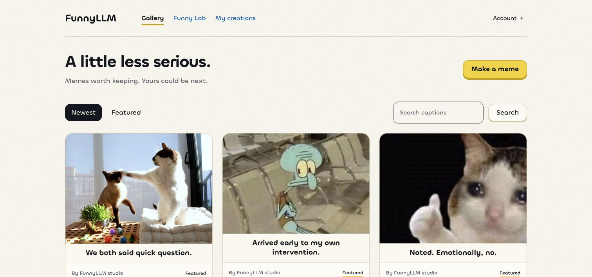
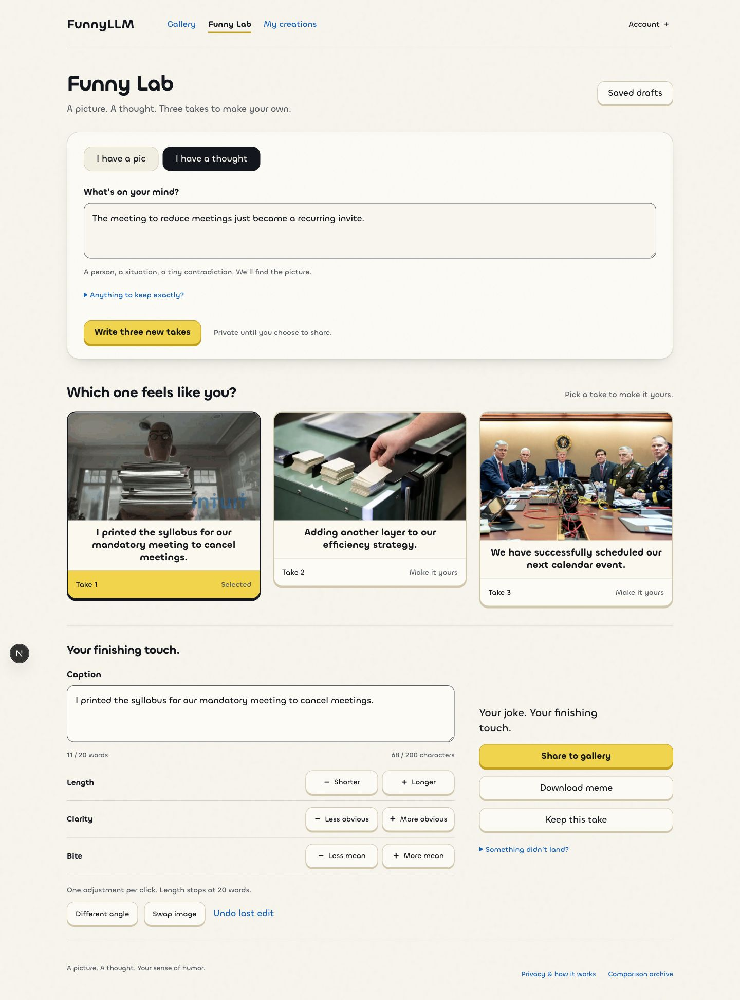
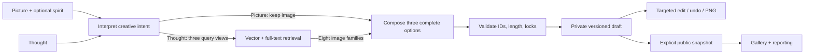

# FunnyLLM

**A picture. A thought. A meme you can make your own.**

FunnyLLM is a meme creation app with a public gallery and an AI co-writer. Start with your own image or an idea, choose from three complete memes, and steer the result before exporting or sharing it.

[Try the gallery](https://funnyllm.vercel.app) · [Open Funny Lab](https://funnyllm.vercel.app/lab) · [Engineering study guide](apps/web/docs/study-guide/README.md) · [Admin app source](https://github.com/yihan2588/FunnyLLM/tree/main/apps/admin)



## Make a meme, then make it yours

| Start with | What happens |
|---|---|
| **I have a pic** | Upload an image and optionally describe its funny spirit. Get three short captions using different comic angles. |
| **I have a thought** | Describe a person, situation, or contradiction. Retrieval finds visual analogies in the teaching catalog; the writer returns three complete image-caption pairs. |

The editor offers **Shorter / Longer**, **Less / More obvious**, and **Less / More mean**, plus a different angle, image swaps in thought mode, manual editing, and undo. Captions stop at **20 words and 200 characters**. A failed edit preserves the last result.

Private drafts stay in **My creations**. Export a captioned PNG, or explicitly publish a snapshot to the gallery. Others can like, save, remix, or report it. Owners can unpublish; admins can feature or remove content. Editing a private draft never silently changes an existing public post.

<details>
<summary>See Funny Lab and its editing controls</summary>



Local release-check capture using the live backend, 29 October 2026. Example output illustrates the flow; it is not evidence of improved humor.

</details>

Anyone can browse the gallery. Any Google account can sign in to create. Admin access is restricted and enforced in the database.

## How it works



- **Retrieve for the joke’s relationship.** Original intent, abstract tension, and visual analogy each contribute vector and lexical results. Reciprocal rank fusion and image-family diversity form a bounded shortlist. The writer chooses image and caption together.
- **Keep the workflow bounded.** Two generation calls; thought mode adds one embedding batch and a database search. No automatic critic loop or self-evolving prompt promotion.
- **Make interaction reliable.** Structured output validation, idempotent request claims, revision checks, frozen model/example snapshots, and saved history protect the user’s work.
- **Operate the whole product.** The companion admin app handles moderation, image upload/re-indexing, request traces, model compatibility checks, few-shot examples, and access.

**Stack:** Next.js 16, React 19, TypeScript, Gemini Interactions API, Zod, Supabase Auth/Postgres/Storage, pgvector + full-text search, Fontkit + Sharp, and Vercel. Dependency versions are pinned in the manifest and lockfile. [Decisions and tradeoffs](apps/web/docs/co-writer.md).

## Monorepo

- `apps/web`: public gallery, Funny Lab, private creations, and its API.
- `apps/admin`: protected operations app and its API.
- Each app retains its lockfile, tests and migration history. Run commands inside the chosen app; the root scripts run both.
- Both Git histories are retained. The former admin repository is a read-only historical archive.

## Run locally

Use Node.js 24 and the pnpm version declared in `package.json`.

```sh
cd apps/web
pnpm install --frozen-lockfile
cp .env.example .env.local
# Configure the four server-side values described in docs/setup.md.
pnpm dev --webpack
```

The application requires a provisioned Supabase database, Google OAuth, Gemini access, and the server writer key. **The migrations extend an earlier course database; cloning this repo is not a complete fresh-database restore.** Read [setup and deployment](apps/web/docs/setup.md) before applying SQL or connecting a different project. Neither application uses a service-role key.

```sh
pnpm test
pnpm lint
pnpm build
```

## Evidence and limitations

The [29 October release record](apps/web/docs/gallery/system.md) reports 59 user-app tests and 51 admin tests, passing lint/type checks/builds, and authenticated browser checks against the live backend. SQL tests execute access, revision, publication, moderation, and runtime contracts in PGlite with pgvector.

The [evaluation harness](apps/web/docs/co-writer.md#evaluation-protocol) compares literal versus relationship-based retrieval and direct versus interpreted picture writing. It produces blinded HTML reviews and task-level analysis. The six committed fixtures are **development smoke cases**. Human preference evaluation is pending: this project does **not yet claim a measured improvement in joke quality**.

Current tradeoffs include one Gemini provider, English/Latin caption rendering, exact search over a small catalog, and database-native traces. Automated retention cleanup and external tracing are deferred. The old A/B interface is a read-only archive at `/compare`; historical data is retained and legacy writes are disabled.

## Repository guide

| Path | Purpose |
|---|---|
| `apps/web/app/` | Gallery, Funny Lab, My creations, sign-in, and API routes |
| `apps/web/lib/cowriter/` | Workflow, prompt contracts, provider calls, layout, and export |
| `apps/web/lib/gallery/` | Publication, gallery access, reactions, and moderation integration |
| `apps/web/supabase/migrations/` | Versioned schema, functions, and access policies |
| `apps/web/tests/` | Deterministic contracts and executable SQL checks |
| `apps/web/scripts/` | Catalog preparation, controlled evaluations, and analysis |
| `apps/web/public/catalog/` | 722 sanitized, content-addressed teaching images used at runtime |
| `apps/web/docs/` | Setup, implementation, release evidence, study guide, and historical records |
| `apps/admin/` | Admin interface, operations API, tests, and documentation |
| `docs/monorepo.md` | Repository layout and deployment mapping |

[Browse the documentation index](apps/web/docs/README.md). Historical snapshots remain labeled and separate from current product guidance. Raw course exports, local credentials, build output, and preparation caches are not part of the published source. Teaching assets retain their original rights; repository inclusion does not grant a new blanket license.
