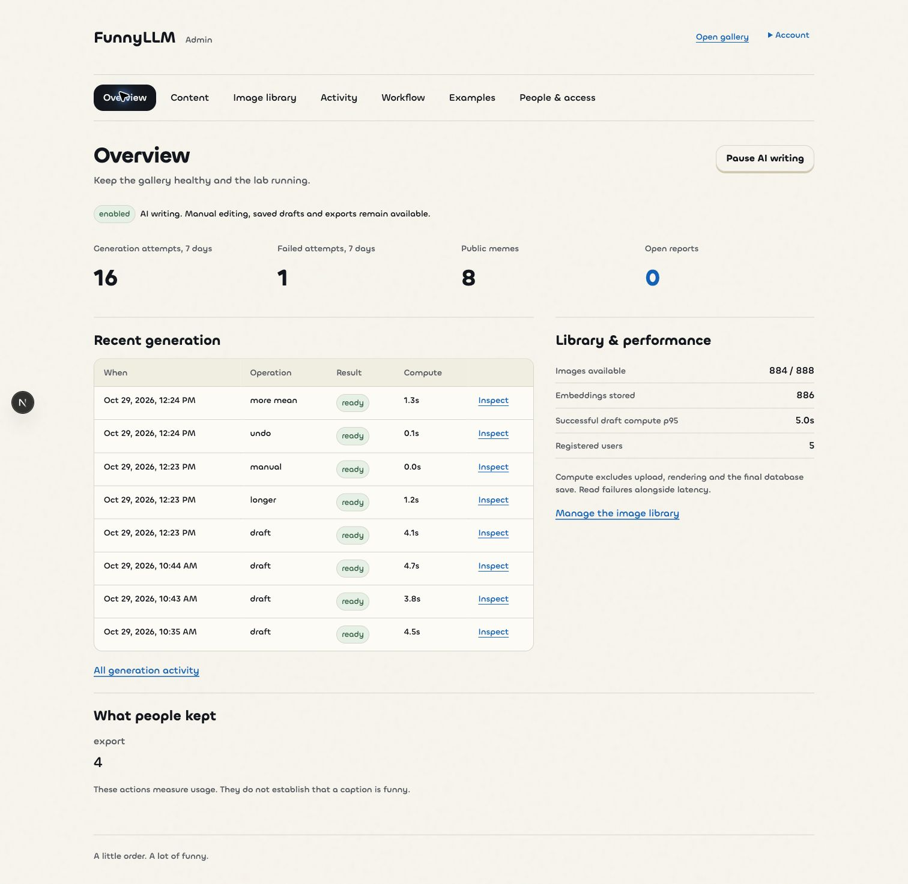

# FunnyLLM Admin

**Operate the meme gallery and AI co-writer from one workspace.**

This is the companion operations app for [FunnyLLM](https://github.com/yihan2588/FunnyLLM). It brings moderation, retrieval assets, generation traces, and model controls into a task-based interface.

[Open the admin app](https://funnyllm-admin.vercel.app/admin) · [Try the public gallery](https://funnyllm.vercel.app) · [System and release evidence](docs/gallery-system.md)



Actual local release-check capture using the live backend, 29 October 2026. Values belong to that test window; they are not current usage, adoption, or reliability claims.

## Organized around the operator’s task

| Area | What an admin can do |
|---|---|
| **Overview** | Review failures, catalog readiness, reports, and draft compute latency; pause AI writing while saved drafts and exports remain usable. |
| **Content** | Inspect gallery media, feature posts, review reports, remove content, and restore it under explicit publication rules. |
| **Image library** | Upload sanitized images, edit descriptions and relationships, regenerate embeddings, and retire images from new retrieval. |
| **Activity** | Inspect request status, errors, results, model usage, and bounded prompt/response traces. |
| **Workflow** | Read the source-controlled co-writer steps; manage Gemini model entries and probe compatibility before activation. |
| **Examples** | Create, edit, and retire few-shot references; at most three active examples enter new drafts. |
| **People & access** | Read users and the exact admin allowlist. |

## Operational contracts

- **Authorization lives in the database.** A verified Google identity must match the exact admin allowlist on every admin read/write. User-editable profile fields and old superadmin flags cannot grant access. All Google accounts remain eligible for the user app.
- **Moderation controls media access.** Removal hides the post, resolves reports, and blocks owner republication. Restoring a user post leaves it unpublished until the owner explicitly republishes it.
- **Changes do not silently rewrite history.** Models and active examples are frozen per draft. Retired images remain available to authorized historical drafts. A model selection probes the actual Interactions API and structured-output support before activation.
- **Traces have a clear boundary.** Private details may contain original input text; secrets and image bytes are excluded. Successful-draft compute p95 excludes upload, browser rendering, and final save. Usage events are not calibrated humor ratings.

There is **one co-writer workflow and one implemented Gemini provider adapter**. Provider information is read-only. The app does not present unused terms, prompt mixes, or signup-domain administration. The admin runtime contains only gallery and co-writer operations. Retired comparison routes, APIs, editors and user-app screens have been removed. Historical records and shared migrations are retained; the historical SQL regression runs from `apps/web/tests/legacy-admin-db.test.mjs`.

## Run and verify

Use Node.js 24 and the pnpm version in `package.json`.

```sh
pnpm install --frozen-lockfile
cp .env.example .env.local
# Configure the provisioned Supabase project and server credentials.
pnpm dev --webpack --port 3001
```

Both apps require the same `SUPABASE_URL`, `SUPABASE_ANON_KEY`, `GEMINI_API_KEY`, and matching `HUMOR_WRITER_KEY`. No service-role key is used. Follow the [shared setup guide](https://github.com/yihan2588/FunnyLLM/blob/main/apps/web/docs/setup.md), including the existing course-database prerequisite and OAuth callbacks. The allowlist is changed through a reviewed migration, not a profile toggle.

```sh
pnpm test
pnpm lint
pnpm build
```

The [29 October release record](docs/gallery-system.md) reports **51 passing admin tests**, passing lint/build/type checks, and authenticated browser verification of the overview, access list, workflow, request details, moderation, and library upload/re-indexing. These checks establish operational behavior; they do not establish improved humor quality.

## Repository guide

| Path | Purpose |
|---|---|
| `app/` | Admin routes, forms, and server actions |
| `lib/` | Authorization, data access, library/media handling, and runtime validation |
| `supabase/migrations/` | Shared schema and access policy history; review the live/local migration mapping before applying |
| `tests/` | Current admin operational, upload and authentication contracts |
| `docs/` | Current release evidence and labeled historical records |

[Documentation index](docs/README.md) · [User-app architecture and evaluation](https://github.com/yihan2588/FunnyLLM/blob/main/apps/web/docs/co-writer.md) · [Engineering study guide](https://github.com/yihan2588/FunnyLLM/tree/main/apps/web/docs/study-guide)
