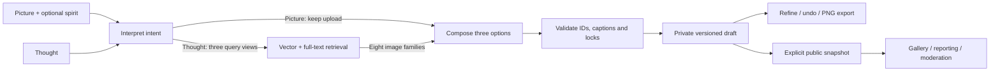

# FunnyLLM

**Turn a picture or a thought into a meme worth sharing.**

FunnyLLM is a full-stack AI meme co-writer with a public gallery. It helps users find a comic angle, choose from three complete options, and refine a caption without losing control of the result.

[Try the gallery](https://funnyllm.vercel.app/) · [Open Funny Lab](https://funnyllm.vercel.app/lab) · [Engineering study guide](docs/study-guide/README.md) · [Architecture](docs/co-writer.md)


## Product

| Start with | Experience |
|---|---|
| **I have a pic** | Upload an image and optionally describe its funny spirit. The writer offers three captions for that image. |
| **I have a thought** | Describe a situation or idea. Retrieval finds useful visual relationships, and the writer returns three image-caption options together. |

Select a take and adjust **Length**, **Clarity**, or **Bite** in either direction. Change the angle, swap a retrieved image, edit the words yourself, or undo. Captions are capped at **20 words and 200 characters**. A failed edit preserves the last saved result.

**My creations** holds private drafts and saved memes. Export a captioned PNG or explicitly publish a snapshot. Gallery visitors can browse; signed-in users can like, save, remix, and report posts. Owners can unpublish; admins can feature or remove content. Private edits do not change an already published snapshot.

New Google signups require an allowed email domain or an individual email exception, managed in Admin → People & access. Existing accounts remain eligible. **Account → Admin** opens the separate operations app; its exact administrator allowlist still controls access. Signed-out browsers show **Sign in**, while signed-in browsers show **Account**.

## Engineering design



- **Task-specific retrieval.** Topic, relationship, and visual-analogy queries each contribute vector and lexical results. Reciprocal rank fusion combines six lists; image-family diversity bounds the shortlist. The model chooses image and caption jointly.
- **Bounded generation.** Two generation calls per new draft; thought mode adds one embedding batch and a database search. Mode-specific prompts and schema-constrained image IDs prevent invalid cross-mode references.
- **Reliable interactions.** Idempotent request claims prevent duplicate work; revision checks reject stale edits. Each draft saves its model and example configuration. Complete options appear with real stage updates and explicit failure states.
- **Publication and authorization.** Private revisions and public snapshots have separate access rules. Database functions and Storage policies enforce ownership and admin permissions.
- **Operational visibility.** The admin app groups moderation, image indexing, generation traces, model selection, examples, and access into seven workspaces.

| Layer | Tools | Why they fit |
|---|---|---|
| Web and deployment | Next.js 16, React 19, TypeScript, Vercel | Separate user/admin apps in one monorepo; server-side credentials and authenticated operations. |
| Generation | Gemini Interactions API, Zod | Multimodal calls with runtime-validated structured output; direct REST for a fixed workflow. |
| Data and retrieval | Supabase Auth/Postgres/Storage, pgvector, full-text search | One data platform for identity, search, private state, publication and access control. |
| Rendering | Fontkit, Sharp | Shared caption layout and font outlines for consistent PNG exports. |
| Verification | Node tests, PGlite + pgvector, browser checks | Validate pure contracts, execute SQL policies, and check the deployed user journey. |

## What this project demonstrates

The engineering challenge is turning a subjective goal—better jokes—into an application people can steer. The implementation separates creative judgment from mechanical guarantees, retrieves relationships rather than only matching nouns, and treats recovery, privacy, moderation, and evaluation as product requirements.

A useful portfolio demo is: **thought → three options → targeted edit → private save → explicit publication → admin trace**. The [study guide](docs/study-guide/README.md) explains each decision, alternatives, failure cases, and interview practice.

**Quality evidence:** automated checks cover validity and access. The offline evaluation harness compares retrieval representations and the value of interpretation using blinded reviews and task-level analysis. The supplied fixtures are development cases. A held-out human study is still needed to claim improved humor; no such gain is claimed here.

## Run locally

Use Node.js 24 and the pnpm version in `package.json`. Each app has its own dependencies and lockfile.

```sh
cd apps/web
pnpm install --frozen-lockfile
cp .env.example .env.local
# Configure Supabase, Gemini and the server writer key.
pnpm dev --webpack
```

Run the admin from `apps/admin` with `pnpm dev --webpack --port 3001`. Read [setup](docs/setup.md) first: the migrations require a provisioned database and are not a complete empty-project bootstrap. Neither app requires a service-role key.

```sh
pnpm test
pnpm lint
pnpm build
```

From the repository root, these checks run both apps. Provider evaluations are separate from normal tests and may incur API charges.

## Explore the code

| Path | Responsibility |
|---|---|
| `apps/web/app/` | Gallery, Funny Lab, creations, account pages and APIs |
| `apps/web/lib/cowriter/` | Prompt contracts, generation workflow, provider, layout and export |
| `apps/web/lib/gallery/` | Publication, media access and gallery interactions |
| `apps/web/supabase/migrations/` | Canonical schema, functions and access policies |
| `apps/web/scripts/` | Catalog preparation and controlled quality evaluation |
| `docs/study-guide/` | Offline interactive engineering and interview guide |
| `apps/admin/` | Operations interface, validation and tests |

Current boundaries: one Gemini adapter, English/Latin caption rendering, exact search over a small catalog, and database-native traces. Automated retention cleanup, a portable database bootstrap, and broader human evaluation are next engineering opportunities. Catalog assets retain their source rights. Raw course exports and credentials are excluded from the repository.

[Documentation](docs/README.md) · [Admin operations](../admin/README.md) · [Deployment map](../../docs/monorepo.md)
