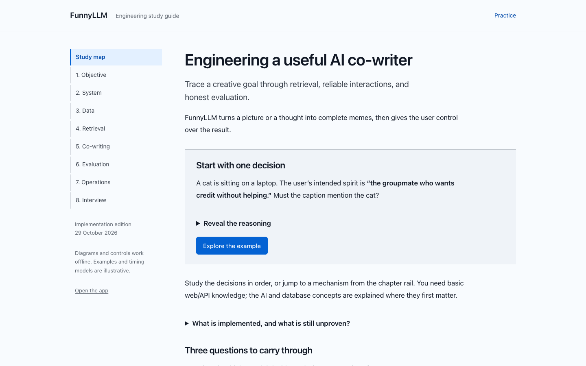

# FunnyLLM engineering study guide

A calm, offline reading guide to the implemented product: creative objectives, workflow design, teaching-data preparation, retrieval, reliable editing, operations, and evaluation.

## Open the guide

Download or clone this repository and open **`docs/study-guide/index.html`** in a browser. Keep the five HTML/CSS/JavaScript files together. GitHub displays the HTML source; it does not run the interactive guide in its file viewer.

No installation, API key, network connection, or external font is needed for the lessons. For a local server, run `python3 -m http.server 8000` from this folder and open `http://localhost:8000`.

## Learn by inspecting the mechanism

- Compare an object pun, an implied connection, and unrelated surprise.
- Trace both creation paths through the same bounded workflow.
- Change a retrieval strategy and calculate reciprocal rank fusion.
- Adjust a critical-path latency model and see the cost of a serial critic.
- Step through private draft, public snapshot, removal, and restoration.
- Test recall with separate hints and answers, then practice eight interview explanations.

The examples are deterministic teaching models, not live generations or benchmark results. Core worked examples remain readable without JavaScript. Printing opens the answer disclosures; no PDF is required.

## Source and evidence

This 29 October 2026 implementation edition is based on [the co-writer decisions](../co-writer.md), [the gallery release record](../gallery/system.md), and the original planning guide. It replaces proposed stack choices with the actual implementation and distinguishes verified behavior from unmeasured humor improvement.

The app keeps its Hum visual theme. This guide uses a restrained Cobalt palette and native system typography for long-form reading. The original Hum guide remains in the workspace deliverable's archive; it is historical planning, not production configuration.

See [verification.json](verification.json) for the scope of checks on this edition. Edit the five guide source files together. A matching local copy is retained in the workspace's `deliverables/funnyllm-cowriter/` folder.
